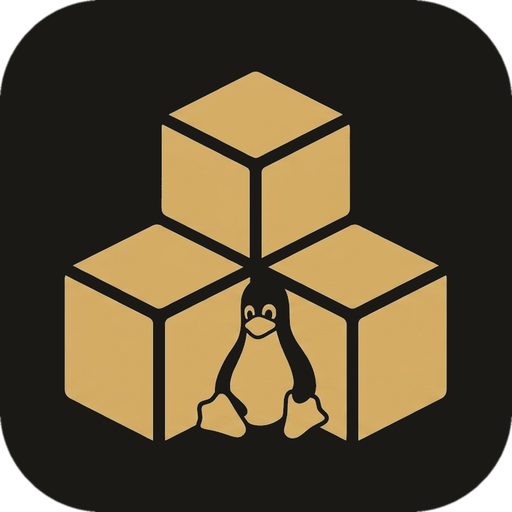

<p align="center">
  
</p>

<h1 align="center">WSL Container Desktop</h1>

<p align="center">
  <b>A lightweight, native control panel for Docker and Podman running in WSL 2.</b><br>
  One executable – no Docker Desktop, no hidden helper distributions, the engine runs in a distribution you control.
</p>

## Why it exists

Docker Desktop is the default way to run containers on Windows, but for everyday development
it is often more than you need. It brings its own helper WSL distributions, background services and a web-based UI
that use memory and CPU even when nothing is running. It is built around Docker Engine only, so
alternatives such as Podman are left out. And commercial use in larger companies requires a
paid subscription.

WSL 2 already ships a full Linux kernel, so a container engine can run directly in a
distribution you already have, with nothing in between. What has been missing is everything
around it: a GUI, a `docker` command that just works from PowerShell, notifications, and the
plumbing between Windows and WSL. **WSL Container Desktop provides exactly that and nothing more.**

## What it does

- **Your engine, your distribution.** Installs and configures **Docker or Podman** in any WSL
  distribution in one step. Keep several distributions with different engines side by side and
  switch the primary one with a single click: the API moves along, and the inactive one can be
  put to sleep.
- **Full container management in a native UI.** Containers, images, volumes, networks and
  compose stacks, with live logs, stats, files inside containers, builds from a Dockerfile and
  volume backups. Written in Rust and egui, without a browser engine.
- **Feels like Docker Desktop from Windows.** `docker` and `docker compose` commands in PATH,
  `DOCKER_HOST` and a named pipe for IDEs and tools, published ports on `localhost`, and
  `host.docker.internal` inside containers – with Podman too.
- **Secure when you want it.** The engine API can be limited to TLS with a client certificate
  generated by the app.
- **Light on resources.** A single ~12 MB EXE that sits in the tray at almost no CPU, collects
  data less often in the background, and helps WSL return unused memory to Windows.
- **Keeps you informed.** Notifications about crashed or unhealthy containers with a full
  history and exit-code explanations, plus alerts for WSL memory and disk space.
- **Also on Linux.** The same app runs on Linux against the Docker or Podman you already have
  (see [Linux](#linux)).

## What's new in 0.9.0

- **Linux support.** On Linux the app connects to an existing local Docker or Podman through its
  unix socket: `DOCKER_HOST`, the active Docker context, `/var/run/docker.sock` or rootless Podman.
  It never installs or reconfigures the engine. WSL-only pages and actions are hidden. The
  password prompt (`pkexec`) appears only when you click a button that needs root, never in the
  background. A `tar.gz` package with a `.desktop` file is built in CI.
- **`wslcd` command.** It does exactly what `docker` does, but always targets the app's engine,
  ignoring `DOCKER_HOST` and `DOCKER_CONTEXT`. It is installed and packaged next to `docker.exe`
  (see [The `wslcd` command](#the-wslcd-command)).
- **Faster and lighter.**
  - Commands inside WSL run through one host layer.
  - The engine API uses a built-in HTTP/1.1 client with keep-alive instead of ureq.
  - While the window is hidden, the app spawns `wsl.exe` less often and samples container
    details less often.
  - The tray menu, lists and the network overview are no longer rebuilt or copied on every frame.
  - `/system/df` is called at most every 30 s, and immediately after storage changes.
  - The notifier's internal maps no longer grow without bound.
  - Measured against 0.8.3: idle CPU of the app −27 %, single-client API throughput +14 %, command
    latency unchanged (`docs/bench/2026-11-22-ab-main-vs-step2.md`).
- **Under the hood.** A `Host` abstraction (WSL now, local Linux, a macOS VM later; see
  `docs/superpowers/specs/2026-11-21-host-abstraction-design.md`). Tests never touch `%APPDATA%`
  and always run with portable data. Clippy is enforced in CI on Windows and Linux.

## Features

| Page | What it does |
|---|---|
| **Overview** (Přehled) | engine status, container / image / volume counts, CPU and RAM available to WSL; tiles side by side: **CPU** of the whole WSL VM (same as the sidebar card) and of containers, with a 15-minute chart of both, **Disk** – engine storage (images, containers, volumes, build cache) against the distribution disk with a usage bar, VHDX and Windows drive and a *Clean up* menu (prune), **WSL memory** summary bar next to its history chart (1 h / 24 h / 7 d / 30 d, kept across restarts) and a *Weekly summary*; live CPU, memory, network and disk stats per running container (with its image and compose stack, against the container's limit when it has one) |
| **Containers** (Kontejnery) | grouped by compose project; start, stop, restart, pause, remove; colored state badges (running, stopped, error with exit code, health); live logs (see *Logs*); **files inside the container**; console in Windows Terminal; *Run container* dialog; **container detail** – click a row (see below) |
| **Images** | **build from a Dockerfile** (see below), search Docker Hub (dialog with tag picker, size and update date), pull by exact name, remove, prune, run a container from an image, which containers use an image |
| **Volumes** | create, remove, prune, **size**, which containers use a volume, browse its content (as root), *run a container with this volume*, **back up to `.tar.gz`, restore, clone** |
| **Networks** (Sítě) | create (bridge, ipvlan, macvlan), remove, prune, subnets, attached containers |
| **Compose** | stacks detected from container labels: up, stop, start, restart, pull, build, ps, logs, down, **scale a service**; **new stack from a template**; **built-in editor for the compose file and `.env` with validation** (Notepad still available); start a stack from any folder (Windows or Linux path) |
| **Kubernetes** | local **single-node k3s** as a container in the primary engine (Docker or Podman): create, start, stop, delete; **environments** (namespaces) from a **FE + API + DB template** (nginx → PostgREST → PostgreSQL) or a **folder of YAML**; pods, services, *Expose on localhost* (NodePort 30080–30099); **flow map** of real connections (conntrack in the node, incl. short HTTP requests); **rules** “who may talk to whom” → NetworkPolicy (enforced by k3s), with **Test connection**; kubeconfig in the app data folder; starts again by itself after a WSL restart; load a local image into the cluster |
| **Files** (Soubory) | file browser for the distribution: navigation, bookmarks, *New* menu (folder, file), *Upload from Windows* menu (files, folder), rename and move, delete, chmod, built-in text editor (Ctrl+S), download to Windows, *Work as root* mode; bulk actions appear only when something is selected, row actions live in a per-row ⋯ menu |
| **WSL engine** | start, stop and restart the engine, put the distribution to sleep, terminal; distribution list (start, sleep, default, **make primary** – moves the API and optionally puts the previous one to sleep, ⋯ *primary with Docker / Podman*, **export, disk & compacting, remove with confirmation**), **import**; *Install & setup* section: Docker / Podman switch, install, API setup, uninstall, `docker` command in PATH, `DOCKER_HOST`, **API security (TLS)**; editor for `/etc/docker/daemon.json` (Docker only) |
| **Settings** (Nastavení) | language (Czech / English), **theme (dark / light / follow Windows)**, primary distribution (switched on the *WSL engine* page) and *Add distribution* wizard, API port, refresh interval (window shown / in the background), keep-alive, engine autostart, restoring containers that were running last time, **start with Windows**, **Windows notifications**, tray behaviour, `docker` command in PATH, global `.wslconfig` (memory, CPU, swap, `vmIdleTimeout`, `networkingMode`) |

The user interface is available in Czech and English (*Settings → Language*).

Less frequent and destructive actions (prune, pause all, …) live in the **⋯** menu next to
the filter field, which is pinned to the right on every page. Tables can be **sorted** by clicking
a column header (ascending → descending → off); directories stay on top in file listings.

### Run container dialog

- Image, name, ports, environment variables, volumes, network, restart policy, command.
- **Shared volumes:** pick an existing volume, set the path inside the container and
  *read-only*, and click *Add*. One named volume can be mounted into any number of containers.
- **Interactive (-it)** opens the container shell in Windows Terminal (removed on exit).
- **sleep infinity** keeps images without their own service (alpine, ubuntu, debian, …) running.
- A few seconds after start the app checks the container state and reports immediately
  exited containers including the exit code.

### Kubernetes lab

*Kubernetes* runs k3s as the container `wslcd-k3s` in the primary engine (network `wslcd-k3s`,
volume `wslcd-k3s-data`, API on `127.0.0.1:6443`, exposed services on `localhost:30080–30099`).
The app talks to the cluster with `kubectl` inside the node, so nothing has to be installed on
Windows; the kubeconfig (context `wslcd`) is written to `<data>\kube\config` – use it with
`$env:KUBECONFIG`. `<data>` is the `data` folder next to the EXE in the portable package (with
`PORTABLE.txt`), otherwise `%APPDATA%\WSL_Container_Desktop`. An *environment* is a namespace
labelled `wslcd.lab=1`.

- **Node** – privileged, with its own cgroup namespace, so k3s and all pods stay inside the
  container's cgroup and the engine's CPU / memory stats (Overview, container table) count the
  whole cluster. Restart policy `unless-stopped`: after a WSL restart the cluster starts by itself,
  a cluster stopped by hand stays stopped. A node created by an older version (shared cgroup
  namespace, restart policy `no`) is recreated on *Start*; the cluster data in the volume is kept.

- **Flow map** – connections from the node's conntrack, grouped by component (label `app`), laid
  out by `tier` (frontend → backend → database); live connections solid, recent (~2 min) grey,
  allowed-but-idle paths dashed green.
- **Rules** – “allow A → B : port” plus *deny everything else* become NetworkPolicies labelled
  `wslcd.managed=1` (DNS stays allowed). *localhost (Windows)* allows NodePort traffic (the engine
  network gateway and the node's pod gateway). Other policies are shown read-only.
- **Test connection** – a TCP connect from inside the source pod's network namespace
  (`nsenter` in the distribution), so the pod's policies apply; from *localhost* it connects to the
  NodePort from Windows.

Design and spike results: `docs/superpowers/specs/2026-11-21-kubernetes-lab-*.md`.

### WSLCD Lite distribution

*Settings → Add distribution → WSLCD Lite* creates a container-only distribution modelled on Kiri
Linux: Alpine minirootfs (pinned and SHA-256 verified), root only, no systemd. A ~200-line POSIX
`systemctl` replacement (`src/lite/systemctl.sh`) runs the same units the engine setup writes
(engine API, TLS proxy, DNS) and starts them from `[boot] command` in `/etc/wsl.conf`; interop with
Windows is off. Like systemd it starts services from `/` with a clean environment in their own
session (otherwise the end of a `wsl.exe` session sends SIGHUP and Podman 5.8 reloads its config
without `volume_path`), and it has a built-in `podman-restart`: after the engine it starts
containers with restart policy `always`, and `unless-stopped` ones unless they were stopped by hand.
*Set up API* refreshes the replacement in existing Lite distributions. The distribution lives in
`<data>\distros\<name>` (in the portable package next to the EXE). Measured: API over
TLS ~1–2 s after a cold start, ~230 MB disk and ~80 MB RAM with Podman (~390 MB / ~165 MB with
Docker); the Kubernetes lab runs in it too.

### Compose templates and editor

*Compose → New stack…* creates a stack from a template – PostgreSQL, MariaDB, Redis, MongoDB,
WordPress + MariaDB, nginx, Adminer, RabbitMQ, Mailpit, MinIO. The project name and folder
(`~/stacks/<name>` by default, Windows paths work too) are prefilled; `compose.yaml` and `.env`
(random passwords, written with mode 600) can be edited before *Create* or *Create and start*.
The content is validated with `compose config -q` before anything is written.

Each existing stack has *Edit compose file* / *Edit .env* (in-app editor, Ctrl+S, *Validate*
runs `compose config -q` on the unsaved text) and a *Scale…* action per service.

### Volume backup, restore and clone

Volumes show their size (`/system/df`, with `du` as a fallback). *Back up…* writes
`<volume>-<date>.tar.gz` to a Windows folder using a throwaway `alpine` container (optionally
stopping the containers that use the volume meanwhile). *Restore from backup…* restores into an
existing volume (optionally emptied first) or a new one; *Clone…* copies a volume.

### Distributions: remove, export, import, disk

The ⋯ menu of a distribution offers *Export…* (`.tar` or `.vhdx`), *Disk and compacting…* (size
of `ext4.vhdx`, sparse mode, `wsl --manage … --compact`) and *Remove distribution…*: a dialog
where the name must be typed, with *Export a backup first* checked by default. The distribution
used by the app for the engine cannot be removed. *Import…* (next to *Add distribution…*) runs
`wsl --import` from a `.tar` / `.vhdx`.

### Sidebar engine card

The card above *WSL engine* in the sidebar shows the primary distribution with the state badge
(the primary distribution is switched on the *WSL engine* page), and below it:

- **Containers · engine** – running / all containers;
- **Kubernetes** – state of the lab cluster (when it exists);
- **CPU** – load of the whole WSL VM and its number of processors;
- **Memory** – memory used by Linux processes out of the VM total;
- **Windows** – RAM in use in Windows out of the physical RAM, with the part taken by the WSL VM
  (VmmemWSL) highlighted in the bar and in the value (`1.7 · 26.1 / 30.7 GB`).

The bars turn yellow from 75 % and red from 90 %; a click opens *Overview*. When the window is too
low for the whole navigation, the card shows only the state and buttons, and the navigation scrolls.

### Tray: containers submenu

The tray menu has a *Containers (n running)* submenu – running ones first, up to 25 – with
start / stop, restart, pause / resume, logs, console and *Show in app* (opens the container
detail) for each container.

### Container detail

A click on a container row (outside the action buttons) or its ⓘ icon opens a resizable window
with tabs:

- **Overview** – state and health, image, command and entrypoint, restart policy, ports, mounts,
  networks with IPs, environment variables (values of keys containing PASS / SECRET / TOKEN / KEY
  are masked until revealed), labels; *Copy JSON*.
- **Stats** – CPU and memory history charts (sampled every ~2 s while the window is open,
  last 5 minutes; 100 % CPU = one core).
- **Logs** – live log with follow and a choice of the last 100 – 5000 lines.
- **Limits** – current memory, reservation, memory + swap, CPUs, CPU shares, cpuset and PIDs;
  memory / reservation / swap / CPUs / PIDs can be changed live (`POST /containers/{id}/update`,
  no restart) with presets. The values are read back after the change, so a limit the engine
  silently ignored is reported. A memory limit below the current usage asks first (OOM risk).
- **Recreate with changes** – a form prefilled from the container (name, image, ports, env,
  volumes, network, restart policy, command). The new container is created through the API from the
  original configuration (`Config` + `HostConfig`) with only the edited fields changed, so user,
  capabilities, security options, read-only rootfs, limits, labels, entrypoint, healthcheck and
  log options are kept. The old container is stopped and renamed to `<name>-wslcd-old`, the new one
  is started; on success the old one is removed, on failure the new
  one is removed and the old one renamed back and started again. **All networks** are kept
  (primary network selectable, aliases, optionally the current / static IP and MAC) and
  **anonymous volumes** are re-attached by name, so their data survives.
- **Files** – the file browser inside the container (also from the folder icon in the row).

### Logs

The log window (and the *Logs* tab of the container detail) has **search with highlighting**
(match count, next / previous with Enter / Shift+Enter, case-sensitive toggle) next to the line
filter, a **timestamps** toggle (local time, full RFC 3339 on hover), **Save…** (all or only the
shown lines) and copy. Only visible rows are laid out, so tens of thousands of lines stay fast;
the buffer keeps the last ~50 000 lines.

*Compose → stack → Logs* opens **merged live logs of the whole stack**: one stream per container,
lines prefixed with the colored service name, ordered by timestamp (300 ms reorder buffer) and
filterable per service. Containers that start later (new replicas, recreated services) are
attached automatically.

### Files inside a container

A file browser for the container's filesystem – sortable listing, navigation, breadcrumbs,
**download to Windows** and **upload from Windows** (`docker cp` style, via the engine's archive
API with a tar guard against path traversal), a built-in editor (≤ 2 MB, UTF-8), new folder,
rename and delete. Running containers are listed through `exec` (busybox and GNU), stopped ones
and images without a shell through the archive API (read-only listing; upload and edit still work).

### Build from a Dockerfile

*Images → Build…* builds an image with the engine CLI inside WSL: context folder (Windows or
Linux path, folder picker), Dockerfile (relative to the context or absolute), tags, build
arguments, target stage, *no cache* and *pull*. The command preview is shown in the dialog and
the output streams into a log window that can be hidden while the build runs. *Cancel build*
stops the CLI and, with Podman, also the `RUN` step running on the server side.

### Live updates and notifications

The app subscribes to the engine event stream (`/events`), so the UI updates immediately after
any change – also changes made from the CLI or compose. Polling then runs only every 30 s as a
fallback (the Overview page keeps the configured interval for live stats); when the stream drops,
the app reconnects with a backoff and polls at the normal interval meanwhile. While the window is
hidden in the tray or minimized, data is collected at a separate, longer interval
(*Settings → In the background every*, 15 s by default) and nothing is drawn; showing the window
refreshes right away.

Every container **crash** (non-zero exit code), **out-of-memory** kill, **unhealthy** health
check and **restart loop** (3 starts within a minute) is recorded on the **Events** page – with
the exit code and its meaning, image, compose project / service, run time, restart policy and
count, engine error, last health-check output and the last 40 log lines (captured right at
`die`, so even `--rm` containers usually keep their log). Repeats of the same problem merge
into one record (`3×`); the history is kept in `container_events.jsonl` in the data folder for
30 days (at most 500 records). The sidebar shows a badge with new problems.

*Settings → Container notifications* chooses what is also shown as a Windows toast: per type,
at most once per N minutes (default 30) for the same container, and muted containers (also from
the record: *Mute <name>*). Routine exits are only recorded, not notified: exit by **SIGTERM /
SIGINT / SIGHUP** (143 / 130 / 129 – a regular shutdown from outside), **temporary containers**
removed right after exiting (`--rm`) and **Testcontainers** (label `org.testcontainers`) – both
can be switched on. Toasts arriving within 2 s (WSL shutdown, compose) are merged into one.
Stops initiated by the user – from the app, the `docker` command or `compose down` – and
stopping the engine are not recorded at all. Clicking a notification opens the record.

### Start with Windows

*Settings → Start with Windows* adds the app to `HKCU\…\CurrentVersion\Run` (no admin rights)
with `--autostart`, which starts it hidden in the tray. Together with *Start the engine when the
app starts* and *restore containers* this works like a background service.

### Add distribution

*Settings → Add distribution…* (also on the WSL engine page) installs a new WSL distribution
in the background:

1. pick a distribution from `wsl --list --online`, optionally a custom instance name;
2. `wsl --install <distro> --name <name> --no-launch` (no interactive first start);
3. preparation as root: systemd enabled in `/etc/wsl.conf`, a default user with passwordless
   `sudo` (optional password), `[user] default=…`;
4. restart of the distribution and a systemd check;
5. optionally install Docker or Podman and switch the app to the new distribution
   (only one distribution can expose the API – all WSL distributions share the network).

Engine installation and uninstallation support apt (Debian, Ubuntu, Kali), dnf (Fedora, Alma,
Oracle, Rocky), zypper (openSUSE, SLES) and pacman (Arch). Progress is shown in an output window.

### Restoring containers

With *Settings → Restart the containers that were running last time* enabled, the app keeps
track of running containers (per distribution and engine, in
`%APPDATA%\WSL_Container_Desktop\last_running.json`) and starts them again once the engine comes up –
e.g. after a WSL restart or a reboot. Stopping the engine, putting the distribution to sleep or
shutting WSL down from the app does not overwrite the list. A restart policy such as
`unless-stopped` on the container is the engine-native alternative.

### Memory overview

*Overview → WSL memory* shows where the RAM taken by WSL goes: **VmmemWSL** (what Windows sees,
read via `NtQuerySystemInformation`) against the WSL limit from `.wslconfig` and the Windows RAM,
and a stacked bar of containers / engine (podman, conmon, dockerd, TLS proxy …) / rest of Linux /
file cache / memory not returned to Windows yet / free (`/proc/meminfo`). Next to it is a history
chart (1 h, 24 h, 7 d, 30 d) with markers for every *Free WSL memory* (before → after). Sampling
runs while the Overview is open, otherwise once a minute.

The history is kept on disk (`history/` in the data folder, about 0.5 MB at most): 1-minute
samples of memory, container CPU, VM traffic, engine storage and distribution disk for 48 hours
and 15-minute min / avg / max for 35 days; the time the app was not running shows as a grey gap.
*Weekly summary* shows peaks and averages, memory freeing, disk growth, traffic and the busiest
hour. *Settings* can turn the history off or delete it.

### Network overview and ports

*Networks* has three tabs:

- **Networks** – the network table plus a map of networks (subnet, gateway) with their containers,
  IPs and aliases.
- **Traffic** – rx / tx of the WSL VM (`eth0`) with a 15-minute chart, traffic per container and
  per compose stack, the WSL networking mode and IP, and the app's own endpoints (engine API with
  TLS state, TLS proxy, named pipe, `docker` shim, DOCKER_HOST).
- **Ports** – published ports (host address → container port, stack, Windows state: forwarded by
  WSL / conflict with another process / not forwarded, *open in browser*, copy) and listening
  sockets of the distribution with known ones labelled (engine API, TLS proxy, DNS).

The container detail has a **Network** tab: **in** – ports the container's processes really listen
on (`ss` in the container's network namespace via `nsenter`, works for images without tools),
compared with the published ones (*not published*, *nothing listens*, *loopback only*); **out** –
established connections with remote address, protocol and process, refreshed every ~2 s, with
**traffic per TCP connection** (bytes and rate from `ss -ti`), a chart of the container's total
traffic and a list of **recently closed connections** (last 15 minutes). UDP has no per-connection
counters (no conntrack). The container list shows a compact in / out count and a warning when a
published port has no listener. The *Ports* tab also checks other running WSL distributions
(read-only, at most every 10 s while the tab is open, never starting a stopped one) and marks a
published port that another distribution listens on as a conflict.

**`localhost` for published ports:** in NAT mode WSL forwards ports to Windows only on IPv4
`127.0.0.1`, and `localhost` → `::1` hangs until a timeout. The app therefore relays every
published TCP port also on `[::1]:<port>` → `127.0.0.1:<port>` (*Settings → Published ports also on
localhost IPv6*, on by default; not needed and not started in `mirrored` mode; a port already taken
on `[::1]` is reported as a conflict). The relay runs only while the app runs; UDP is not relayed.

### Alerts

Windows notifications (and a banner on the Overview with an action button) when a threshold is
crossed – *Settings → Memory and disk alerts*, each with its own switch and threshold:

- VmmemWSL above 85 % of the WSL memory limit for 2 minutes (offers *Free memory*);
- Linux memory pressure – MemAvailable below 10 %;
- free space inside the distribution (`df /`, with the VHDX size), on the Windows drive holding
  the VHDX (below 10 % or 5 GB) and for the engine data (`/var/lib/containers` or
  `/var/lib/docker`);
- engine storage (images, containers, volumes, build cache) above a size – off by default.

Memory is checked with every memory sample, disk at most every 5 minutes. Alerts have hysteresis
(they re-arm only 5 points below the threshold) and repeat at most once per hour; clicking the
notification opens the relevant page.

### WSL memory

VmmemWSL keeps memory that Linux used as file cache (pulled images, builds) even when it is no
longer needed. *Overview → Clean up → Free WSL memory* (also in the tray menu) drops the Linux
page cache and compacts memory, so the VM returns it to Windows, and reports VmmemWSL before and
after. *Settings → Free WSL memory automatically* (on by default) does the same at most every
10 minutes when the cache exceeds 1 GB. The `.wslconfig` editor also offers `autoMemoryReclaim`
(`dropCache` / `gradual` / `disabled`), which WSL itself applies when the VM is idle.

### Tray

A tray icon with a status dot (green = engine running) and a tooltip. Left click shows or
hides the window, right click opens a menu: status, open, start / stop / restart the engine,
sleep the distribution, pause and resume containers, terminal, files in Explorer,
*close / minimize to tray* toggles and Quit. By default both close and minimize only hide the
window (configurable in Settings); a hidden window is kept minimized off-screen, so the app
uses almost no CPU in the tray. The app runs as a single instance – starting it again just
shows the running window. Windows 11 puts icons of new apps into the hidden part of the tray
(^ arrow); pin it via *Settings → Personalization → Taskbar → Other system tray icons*.

### Docker / Podman engine

The engine is selected per distribution on the *WSL engine* page.

- **Primary distribution:** several distributions can each have their own engine (for example
  Docker in Ubuntu, Podman in Debian), but only one – the *primary* – serves the app API on
  `127.0.0.1:<port>`, the `docker` command and all pages. *Make primary* (in the distribution
  list) detects the engine in the
  target distribution (or uses the one chosen in its ⋯ menu), turns off the TCP API in the other
  distributions – their engines and containers keep running on the unix socket – and sets up the
  API in the target. The previous primary is put to sleep (`wsl --terminate`) by default; the
  checkbox in the confirmation dialog keeps it running. Running non-primary distributions have a
  *Sleep* button. The last engine used in each distribution is remembered.
- **Install & setup:** installs the engine via apt, dnf, zypper or pacman (Docker from the
  distribution packages – `docker.io` on Debian/Ubuntu, `moby-engine` on Fedora, the official
  Docker repository on RHEL-like systems; Podman from the distribution). If systemd is not running,
  it enables it in `/etc/wsl.conf` and restarts the distribution. Then it sets up the TCP API and
  verifies it responds. Progress is shown in an output window.
- **Uninstall:** disables the services, removes the API setup and the engine packages with the
  distribution's package manager (apt purge, dnf / zypper / pacman remove) – it detects which of
  the known package variants are installed (docker-ce, docker.io, moby-engine, docker, podman, …).
  `docker-compose` is kept when Docker is still installed. Optionally deletes the data as well
  (`/var/lib/docker…` or `/var/lib/containers`).
- **Podman** runs as the rootful service `wslcd-podman-api`
  (`podman system service tcp://127.0.0.1:<port>`). The app talks to it through the same
  Docker-compatible API. CLI commands (running a container, compose, console, logs, the shim)
  are translated to `podman --url tcp://127.0.0.1:<port> …`, so they see the same containers.
  Short image names are expanded to `docker.io/library/…`. `docker-compose` is installed as the
  compose provider. Setting up one engine disables the other so they don't fight over the port.
- **Docker and Podman side by side:** all WSL 2 distributions share one network namespace. Docker
  sets the iptables policy `FORWARD DROP` when it enables forwarding itself (it starts first after
  WSL boots), which would cut Podman containers in another distribution off the network. The Docker
  setup therefore adds a `docker.service` drop-in that accepts traffic of Podman bridges
  (`podman+`) in the `DOCKER-USER` chain (iptables and ip6tables).
- **`host.docker.internal`** resolves inside containers like in Docker Desktop. Podman provides it
  itself (its bridge gateway); for Docker the API setup starts a small DNS forwarder
  (`dnsmasq`, service `wslcd-dns`) on `172.17.0.1` and runs `dockerd --dns 172.17.0.1`:
  `host.docker.internal` and `gateway.docker.internal` resolve to `172.17.0.1`, everything else
  goes to the distribution's DNS. This works for `docker run`, compose and API clients alike.
  It is skipped when `daemon.json` sets `dns` or `bip`. The address is the WSL distribution, so
  it reaches ports published by other containers and services in the distribution, not services
  running directly on Windows.

### API security (TLS)

Without TLS the engine API on `tcp://127.0.0.1:2375` has **no authentication** – any process that
can reach localhost can control the (rootful) engine, including other WSL distributions and
containers with host networking, because all WSL 2 distributions share one network namespace.
**New installations** (*Install and set up*, *Add distribution* with an engine) therefore use TLS
by default (checkbox *Secure the API with TLS*); existing setups show a one-time hint.

*WSL engine → Install & setup → API security → Turn TLS on* switches to mutual TLS:

- the engine listens only on a unix socket inside the distribution (Docker `/var/run/docker.sock`,
  Podman `/run/wslcd-podman/podman.sock`); access is granted to the group `docker` / `wslcd-api`,
  which the default user of the distribution is added to;
- a CA, a server certificate (`127.0.0.1`, `localhost`) and a client certificate (EC P-256) are
  generated in `/etc/wsl-container-desktop/tls`; the client certificate, key and CA are copied to
  `%APPDATA%\WSL_Container_Desktop\tls` – the key encrypted with DPAPI (`key.pem.dpapi`); a plain
  `key.pem` for `DOCKER_CERT_PATH` is written only when *DOCKER_HOST* is set for external tools;
- the systemd service `wslcd-tls-proxy` (`socat`, installed if missing) listens on
  `127.0.0.1:2376` and accepts only clients presenting the client certificate; it starts and
  stops together with the engine;
- the app connects over HTTPS with the client certificate (rustls); the CLI inside WSL and the
  `docker` shim use the unix socket.

Certificates expiring within 30 days are renewed on the next API setup; *Regenerate
certificates* creates a new CA and certificates at any time. *Turn TLS off* switches back to the plain API on port 2375 and removes the proxy (the
certificates are kept and reused). See [docs/SECURITY.md](docs/SECURITY.md) for the security
review.

**Named pipe for tools:** *Settings → Named pipe for tools* starts a relay on the standard
Docker pipe **`\\.\pipe\docker_engine`** – the same one Docker Desktop uses (DACL: only the
current user and SYSTEM, remote clients rejected). It forwards to the engine API of the primary
distribution, over TLS when enabled, so tools never need the client key. Docker CLI,
Testcontainers (Java and .NET), VS Code and Docker SDKs try this pipe when `DOCKER_HOST` is not
set, so **`DOCKER_HOST` should stay unset** – that also sidesteps the different pipe URL forms
(`npipe:////./pipe/…` for Go tools, `npipe://./pipe/…` for Docker.DotNet). The pipe exists only
while the app runs; when Docker Desktop already holds it, the relay does not start and the app
says so.

### `docker` command for Windows (shim)

The project also builds a small `docker.exe` (`src/shim/docker.rs`) that forwards commands to
the engine inside WSL: `docker ps` on Windows runs as
`wsl.exe -d <distro> --cd <current folder> -e docker ps` (or `podman --url … ps` for Podman).
The distribution and engine come from the WSL Container Desktop settings. Windows paths in arguments are
translated (`-v D:\data:/data`, `--mount source=C:\x`, `-f C:\p\compose.yml`, `.\data`,
`\\wsl.localhost\Debian\…`) and the exit code of the command is returned. When named
`docker-compose.exe` it behaves like `docker compose`.

#### The `wslcd` command

`wslcd.exe` is the same binary as `docker.exe` (it is told apart by its file name), so
`wslcd <args>` behaves exactly like `docker <args>` – including the API fast path, auto-start, contexts,
path translation and `wslcd compose …` – but it always targets the WSL Container Desktop engine:
`DOCKER_CONTEXT` and `DOCKER_HOST` from the environment are ignored, so `wslcd ps` never lands on Docker Desktop
or another engine. `wslcd --context <app context>` still works. It is installed next to `docker.exe`
(*Add to PATH*, portable package: already in the app folder) and removed together with it.

`wslcd` (not `docker`) also has commands that control the app from the command line – for scripts
and automated tests: `wslcd status`, `wslcd distro ls|use|start|stop`, `wslcd engine start|stop|restart`,
`wslcd memory free` and `wslcd metrics` (memory and CPU counters of the app, Windows, the WSL VM and
containers), all with `--json`. They talk to the running app over a per-user named pipe and start it
when needed. See [docs/WSLCD-CLI.md](docs/WSLCD-CLI.md) (`wslcd help-wslcd`).

Install it from *WSL engine → Install & setup* (or *Settings*): it is copied to
`%LOCALAPPDATA%\WSL_Container_Desktop\bin` and that folder is added to the user PATH (no admin rights).
The check reads PATH from the registry (machine, then user – what a new terminal sees) and warns
only about another `docker` that comes *before* ours. Other copies of the WSL Container Desktop shim – older
portable versions in PATH, a repeated entry, a PATH entry of a moved package, leftovers in
`%LOCALAPPDATA%\WSL_Container_Desktop\bin` after switching to portable – are listed with *Remove
duplicates*: PATH keeps the current folder once, other package folders are only removed from
PATH (never deleted), copies in the default install folder are deleted.

To behave as close to the Docker CLI as possible:

- **Environment variables from Windows** are forwarded via `WSLENV` – only what the command
  needs: `-e VAR` / `--env VAR` without a value, variables used in compose files
  (`${VAR}`, `$VAR`), plus anything listed in `WSLCD_FORWARD_ENV=A,B`. `DOCKER_HOST`, `PATH`
  and similar are never forwarded.
- **Paths in BuildKit options** are translated too: `--secret src=…`, `--output dest=…`,
  `--build-context x=…`, `--cache-from` / `--cache-to`, `--ssh`, `save -o …`. Values of `-e`,
  `--label`, `--build-arg` and `--filter` are left untouched. Network paths (`\\server\share`)
  that WSL cannot see produce a warning.
- **`DOCKER_HOST` for tools** that talk to the API directly instead of calling the CLI
  (VS Code Dev Containers, Testcontainers, SDKs): the *WSL engine* page can set the user
  variable `DOCKER_HOST=tcp://127.0.0.1:<port>` (with TLS also `DOCKER_TLS_VERIFY=1` and
  `DOCKER_CERT_PATH`).

**Fast path:** simple read-only commands – `ps` / `container ls` (with `-a -q -l -s -n
--no-trunc`, `--filter status|name|label|ancestor`, `--format table|json|{{.Field}}`), `images`,
`volume ls`, `network ls` (with filters and `--format json`), `inspect` / `container inspect` /
`image inspect`, `logs` without `-f`, `version --format`, `info --format` – are answered directly
from the engine API (also over TLS) in ~50 ms instead of ~250 ms via `wsl.exe`. Output mimics the Docker
CLI. Anything else (unknown flag, template function, API error) silently falls back to
`wsl.exe`. `WSLCD_SHIM_FAST=0` disables the fast path.

**Auto-start:** you don't have to start anything first. If the app is not running, the first
command that needs the engine (`docker ps`, `docker compose up`, … – not `help`, `context` or
`--version`) starts the app hidden in the tray (`--from-shim`), the app boots WSL and starts the
engine, and the shim waits for the API (up to 120 s, `WSLCD_SHIM_WAIT=<s>`). If the app is running
but the engine is not, the shim asks it to start the engine. When both are up the check costs about 1 ms.
This applies only to the app's primary target (not to other contexts). Turn it off in *Settings*
(“The docker command in Windows starts the app and the engine…”) or with `WSLCD_SHIM_AUTOSTART=0`.

**Quit and shut down WSL:** the tray menu item *Quit and shut down WSL (free memory)* quits the app
and runs `wsl --shutdown`, so VmmemWSL returns its memory to Windows. This stops **all**
distributions, not only the app's. The setting *Shut down WSL when the app quits* does the same on
every quit. The next `docker` command starts everything again (see Auto-start).

Debugging: `WSLCD_SHIM_DEBUG=1` prints the executed command (and whether the fast path was used); `WSLCD_ENGINE=podman|docker`,
`WSLCD_PORT` and `WSLCD_DISTRO` override the settings.

**Path translation** covers volume and mount flags, file flags (`--env-file`, `--label-file`,
`--cidfile`, `--iidfile`, `--metadata-file`, `--device`, `--security-opt seccomp=`, `--log-opt
path=`), `cp` (only the host side), `build -f`, BuildKit options, `compose -f/--env-file/
--project-directory`, `load -i`, `save`/`export -o`, `import <file>` and the global `--config`;
the list of deliberately untranslated flags is at the top of `src/pathmap.rs`.

**Contexts:** `docker context ls|show|use|create|rm|inspect` manage WSL Container Desktop targets (distribution +
engine + port + TLS) stored in `contexts.json` next to the app configuration; `default` is the
app's current setting (its endpoint shows `DOCKER_HOST` when that variable is set, like the Docker
CLI, which also warns when `DOCKER_HOST` overrides a selected context).
`docker context create dev --distro Ubuntu --engine docker`, then
`docker --context dev ps`, `DOCKER_CONTEXT=dev` or `docker context use dev`.

Remaining differences from the Docker CLI for Windows: `docker login` and `config.json` live
inside WSL; commands outside the fast path have the overhead of starting `wsl.exe`
(~0.1–0.3 s); Podman has no swarm.

With **Podman** the shim smooths over differences that break Docker scripts: `docker ps` and
`docker compose ps` show the health state (`Up 5 seconds (healthy)`, from the libpod list API /
the compose `Health` field – also in custom templates such as `--format '{{.Service}}={{.Status}}'`);
image names are shown the way Docker shows them – without `localhost/` and `docker.io/library/`
(`myapp:1.0`, `nginx:alpine`) in `images`, `compose ps` and `RepoTags` / `RepoDigests` of
`image inspect`; `docker images <name>` and `--filter reference=` match these short names (Podman
would also return the base image); published ports show the host address
(`0.0.0.0:8080->80/tcp`), which Podman's API leaves out; `docker version` – plain or with
`--format`, including `.Client.*` fields – reports the compatible API version (1.41), not
Podman's own version, and the client version of the matching Docker release (`20.10.0` for
API 1.41), so version checks in scripts pass; the WSL Container Desktop version appears only in the plain
output header;
`docker events` reads the compatible API stream, so the default line, `--format json` and simple
templates (`{{.Action}} {{.Actor.Attributes.name}}`) have Docker's schema, including
`health_status: healthy` – more complex templates (`if`, `index`) go to `podman events` with Docker
fields translated; `docker buildx ls|create|use|inspect|rm|bake|imagetools…` run the real
buildx plugin (when the distribution has the Docker CLI with `docker-buildx`) against the Podman
API – the `docker-container` driver runs BuildKit in a container and `--load` imports the image
into Podman. `buildx build` stays on Buildah unless a custom builder is selected (`--builder`,
`BUILDX_BUILDER`, `buildx use`). Pull progress of Podman goes to stderr (Docker: stdout).

The Podman setup also configures the distribution like Docker: short image names are looked up
on Docker Hub (`unqualified-search-registries = ["docker.io"]`, so `postgres:16-alpine` works),
Podman aliases that point elsewhere are redirected to Docker Hub (`hello-world`, `fedora`,
`centos`, …; `/etc/containers/registries.conf.d/zz-wsl-container-desktop.conf`), and `/var/run/docker.sock`
links to the Podman API (`/etc/tmpfiles.d/wslcd-docker-sock.conf`) for tools and
Docker-outside-of-Docker containers. Switching to Docker removes the link. The TLS proxy accepts
up to 256 concurrent connections with a listen backlog of 128 (Testcontainers, parallel CI).

Consoles and log tails open in **Windows Terminal** (`wt.exe`), falling back to a classic
console window when it is not available.

## How it works

- **Engine API over TCP:** without TLS the engine listens besides its socket on
  `tcp://127.0.0.1:2375` (no authentication). For Docker this is a systemd override
  `/etc/systemd/system/docker.service.d/10-wsl-container-desktop-tcp.conf`, for Podman the unit
  `/etc/systemd/system/wslcd-podman-api.service`. With TLS the engine stays on its unix socket and
  only the `wslcd-tls-proxy` listens on `127.0.0.1:2376` (see *API security*). WSL forwards the port
  to `127.0.0.1` on Windows automatically; the app adds `[::1]` (see *Network overview and ports*).
- **Live updates:** a background thread reads the engine event stream (`/events`) and triggers a
  debounced refresh; the same events drive the Windows notifications.
- **Worker:** short actions (API calls, listings) run in a small thread pool, long ones
  (installation, build, compose, backups) in their own thread; all API calls share one HTTP agent
  with keep-alive. API errors are typed (`ApiError`: HTTP status, unreachable engine, decode).
- **WSL operations** (starting / stopping the distribution, `systemctl`, compose, file
  operations) run via `wsl.exe -d <distro> [-u root] -e …`.
- **Switching distributions:** *Make primary* on the WSL engine page (see
  *Docker / Podman engine*); a distribution without an engine becomes primary and offers
  *Install & setup*. Requirements: systemd (`[boot] systemd=true` in `/etc/wsl.conf`, set up automatically by
  *Install & setup*) and apt, dnf, zypper or pacman for automatic installation.
- **Keep-alive:** WSL stops an idle distribution – together with the engine. The app therefore
  runs a hidden `wsl.exe … flock … sleep infinity` that runs at most once per distribution and
  keeps running after the app is closed, so the engine stays up. **Sleep** stops it and shuts
  the distribution down.

The app configuration is stored in `%APPDATA%\WSL_Container_Desktop\config.json` (in portable mode in
`data\` next to the EXE).

*Renamed from WLS Desktop:* on first start the data folder `%APPDATA%\WLS_Desktop` is renamed to
`%APPDATA%\WSL_Container_Desktop`, the *Start with Windows* entry is moved to the new name and
path, and a leftover `docker` command in `%LOCALAPPDATA%\WLS_Desktop\bin` is offered for removal
under *Remove duplicates*. Inside the distributions the services are now `wslcd-*`
(`wslcd-podman-api`, `wslcd-tls-proxy`, `wslcd-dns`, group `wslcd-api`) and the certificates live
in `/etc/wsl-container-desktop/tls`; any API setup, primary switch or uninstall removes the old
`wls-*` services, files and group first (new certificates are generated). The `WSLCD_*`
environment variables used for debugging and tests are unchanged.

## Linux

The same app also runs on Linux (x86_64, GTK 3) as a plain control panel for a container engine
that is already there: **Docker** (`/var/run/docker.sock`) or **rootless Podman**
(`$XDG_RUNTIME_DIR/podman/podman.sock`). On Linux the app never installs or configures anything:
no engine setup, no changes to `docker.service`, groups or system files.

**Works:** containers, images, volumes, networks, compose stacks, Kubernetes lab, logs, stats, files
inside containers, builds, volume backups, the Events page and notifications (`notify-send`),
start at login (XDG autostart file `~/.config/autostart/wsl-container-desktop.desktop`).
There is **no tray icon on Linux yet**: closing the window quits the app.

**Not available** (hidden in the UI): everything that belongs to WSL – distributions and the
*WSL engine* page, Add distribution wizard, WSL memory and VHDX disk tools, `.wslconfig`, the
`docker` shim, the named pipe and the `localhost` relay. Remote engines (`ssh://`, `tcp://` other
than localhost) are not supported either; the app shows a message and uses the local socket.

**Socket access.** Docker: add yourself to the `docker` group and log in again
(`sudo usermod -aG docker $USER`). Podman: `systemctl --user enable --now podman.socket`.
The app never changes these settings itself and never calls `pkexec` on its own.

**Files:** configuration in `$XDG_CONFIG_HOME/wsl-container-desktop` (default `~/.config/...`),
data in `$XDG_DATA_HOME/wsl-container-desktop` (default `~/.local/share/...`).

**Package.** Releases carry `WSL-Container-Desktop-<version>-linux-x64.tar.gz` (+ `.sha256`) with
the binary, a `.desktop` file, the icon and `README-linux.txt`. Runtime libraries (Debian / Ubuntu):
`libgtk-3-0`, `libxdo3`, `libayatana-appindicator3-1` (the binary links them, no tray is shown); optionally `libnotify-bin`. To build it
yourself:

```bash
scripts/package-linux.sh 0.9.0-dev        # on Linux with the build dependencies, output in dist/
```

From Windows, the same script runs in the dev container inside the WSLCD-Lite distribution
(repository mounted read-only, only `dist/` is written):
`powershell -ExecutionPolicy Bypass -File scripts\linux-test.ps1 package 0.9.0-dev`
(`check` and `test` modes build and test the Linux target the same way). The GitHub workflow
`linux` builds, tests and attaches the archive to the release on `v*` tags.

## Building

Requirements: Rust (MSVC toolchain) and Visual Studio Build Tools with C++ (including the
Windows SDK – `rc.exe` is used to embed the icon).

The icon is made from `assets/icon.jpg`: `python scripts/make_icon.py` (Pillow) writes
`assets/icon.png` (README) and the prepared sizes in `assets/icon/*.rgba`, which `src/icon_art.rs`
embeds for the EXE, window, tray (with a status dot) and notifications.

```bash
cargo build --release
```

Output: `target\release\wsl-container-desktop.exe` (~8 MB, no runtime dependencies) and
`target\release\docker.exe` (the shim).

### Portable package

```bash
powershell -ExecutionPolicy Bypass -File scripts\package.ps1
```

creates `dist\WSL-Container-Desktop-<version>-win-x64.zip` (+ `.sha256`) with both EXEs, the README and
`PORTABLE.txt`. When `PORTABLE.txt` lies next to `wsl-container-desktop.exe`, the app runs in **portable
mode**: settings, certificates and other data go to `data\` next to the EXE instead of
`%APPDATA%\WSL_Container_Desktop`, and *docker command in PATH* adds the app folder itself to PATH. Delete
the file to switch to the normal mode. On the first start the default WSL distribution is
preselected.

### Production build / release

```bash
powershell -ExecutionPolicy Bypass -File scripts\release.ps1 -Version 1.0.0 -Tag
```

1. checks that the working tree is clean (the package must match a commit);
2. with `-Version` sets the version in `Cargo.toml` and commits it;
3. runs `cargo clippy --all-targets -- -D warnings` and `cargo test` (`-LiveTests` also runs the
   ignored live tests against WSL);
4. builds the release and the portable ZIP;
5. with `-Tag` creates the tag `vX.Y.Z` – `git push origin main vX.Y.Z` then lets GitHub
   Actions (`.github/workflows/release.yml`: clippy, tests, package) publish a GitHub release with
   the ZIP and its SHA-256. Every push to `main` builds the ZIP as a workflow artifact;
6. cleans up (`scripts\cleanup.ps1`, skipped with `-NoCleanup`): stale intermediate build
   results of the app in `target\` (incremental sessions and old `build\wsl-container-desktop\<hash>`
   folders that every version bump leaves behind), the whole debug profile when `target\` still
   exceeds 10 GB, and packages older than the last 3 versions in `dist\`. It can also be run on
   its own (`-KeepDist`, `-MaxGB`).

Besides the portable ZIP, `package.ps1` builds `…-winget.zip` without `PORTABLE.txt` (data in
`%APPDATA%`, so it survives upgrades) for the Windows Package Manager.

### Code signing

`scripts/sign.ps1` signs `wsl-container-desktop.exe` and `docker.exe` with Authenticode (SHA-256, RFC 3161
timestamp); `package.ps1 -Sign` / `release.ps1 -Sign` call it before packaging. The signing method
is chosen by environment variables:

| Method | Variables | Notes |
|---|---|---|
| **Azure Artifact Signing** (formerly Trusted Signing) | `WSLCD_SIGN_DLIB` (x64 `Azure.CodeSigning.Dlib.dll`), `WSLCD_SIGN_METADATA` (`metadata.json` with endpoint, account, certificate profile) + `AZURE_*` credentials or `az login` | recommended; ~10 USD / month; individuals only in the USA / Canada, organizations also in the EU; client tools: `winget install -e --id Microsoft.Azure.ArtifactSigningClientTools` |
| Certificate in the Windows store (USB token, HSM, cloud HSM such as DigiCert KeyLocker or SSL.com eSigner) | `WSLCD_SIGN_THUMBPRINT` | classic OV / EV certificate; since 2023 private keys must be on an HSM |
| PFX file | `WSLCD_SIGN_PFX`, `WSLCD_SIGN_PFX_PASSWORD` | older certificates or testing (`-AllowUntrusted` accepts a self-signed test certificate) |

The ZIP itself cannot carry an Authenticode signature – the signed EXEs inside it and the published
SHA-256 are what users verify (`Get-AuthenticodeSignature`, `Get-FileHash`). In GitHub Actions the
EXEs are signed automatically when the repository has the secrets `AZURE_TENANT_ID`,
`AZURE_CLIENT_ID`, `AZURE_CLIENT_SECRET` and the variables `SIGNING_ENDPOINT`, `SIGNING_ACCOUNT`,
`SIGNING_PROFILE` (see `.github/workflows/release.yml`); otherwise the packages are unsigned.
Open-source projects can alternatively apply to the free SignPath Foundation (public repository
and an OSI license required).

### winget

`scripts/winget.ps1` generates the manifests (`dist\winget\manifests\d\dyeabel\WSLContainerDesktop\<version>\`:
version, installer and en-US locale, schema 1.10) for the `-winget.zip` release asset – installer
type `zip` with the nested portable `wsl-container-desktop.exe` and the command alias `wsl-container-desktop` – and
checks them with `winget validate`. CI attaches the manifest to the workflow artifacts. Publishing
to the community repository means a pull request to `microsoft/winget-pkgs` (e.g.
`wingetcreate submit <folder>`); it requires a **public** download URL, i.e. a public repository
(or another public host for the ZIP), and a license entry (`-License`).

## Benchmark

How Docker and Podman perform inside the app – latency of the app API, the `docker` command and plain `wsl.exe`, API load
tests, 50 containers at once, resource footprint – see **[docs/BENCHMARK.md](docs/BENCHMARK.md)**. Reproduce with
`powershell -ExecutionPolicy Bypass -File scripts\bench.ps1` (`-Quick` for a ~2 minute smoke run); it switches the primary
distribution for each engine like *Make primary* and switches back at the end.

## Tests

```bash
cargo test
```

**Docker end-to-end test** – `cargo test live_docker_e2e -- --ignored --nocapture` creates a fresh
distribution `WSLCD-Test-Docker`, installs Docker from the distribution packages the same way the
app does and goes through the plain and the TLS API, containers, events, build, compose,
*Recreate* and the `docker.exe` shim, then unregisters the distribution (~3 minutes; port 2385,
`iptables: false` so the shared WSL network of other engines is not touched, app data in a
temporary `WSLCD_DATA_DIR`; `WSLCD_E2E_KEEP=1` keeps the distribution for debugging). In GitHub
Actions it runs via the manually started workflow `e2e` on a self-hosted Windows runner with the
labels `self-hosted, windows, wsl` (running under a normal user account – WSL distributions are
per user); see `.github/workflows/e2e.yml` for the requirements.

Integration tests against a real WSL distribution and engine (distribution from `WSLCD_DISTRO`,
default `Ubuntu`; the Podman test expects an API on `WSLCD_PODMAN_PORT`, default 2376).
`live_add_distro` installs and removes a temporary Debian (`WSLCD-Test-Debian`),
`live_pkg_helpers` checks install / detect / remove in throwaway Fedora, openSUSE and Arch
containers (needs the Podman API on `WSLCD_PORT`, default 2375). `live_events_stream`,
`live_build_image` and `live_container_detail` work with throwaway `wslcd-test-*` containers and
images, `live_tls_proxy` runs a temporary Podman socket with the TLS proxy on port 2377 and checks
that only a client with the certificate gets through, `live_autostart_roundtrip` writes and
removes the Run registry value:

```bash
cargo test -- --ignored --test-threads=1
```

`live_k8s_lab` (`$env:WSLCD_K8S_DATA="C:\WSLContainerDesktop\data"; cargo test live_k8s_lab -- --ignored --nocapture --test-threads=1`)
creates the cluster in the engine from the app configuration (config and TLS certificates are
copied into an isolated data folder), deploys the template with sample rules, checks the page
through the NodePort from Windows, the connection tests (`fe → db` blocked) and the flow map, and
deletes the cluster. `live_k8s_start_existing` (same variable) starts an existing cluster like the
*Start* button – including the conversion of an older node – and deletes nothing. `live_lite_distro` (`cargo test live_lite -- --ignored --nocapture`) creates
`WSLCD-Lite-Test` with Podman and TLS on port 2387 (`WSLCD_LITE_ENGINE=docker` for Docker,
`WSLCD_LITE_K8S=1` also starts k3s in it), measures the cold start and unregisters it.

`live_net` (`cargo test live_net -- --ignored --nocapture`) checks the network overview (traffic,
ports, in / out connections) against the engine from the app configuration.

For debugging and screenshots: `WSLCD_START_PAGE` selects the start page (`containers`, `images`,
`volumes`, `networks`, `compose`, `files`, `engine`, `settings`; Overview otherwise),
`WSLCD_DEBUG_DIALOG=1` shows a sample confirmation dialog, `WSLCD_DEBUG_HUB=<image>` opens the Docker
Hub dialog, `WSLCD_DEBUG_EXPAND=1` expands the engine setup section, `WSLCD_DEBUG_BUILD=1` opens the
build dialog,
`WSLCD_DEBUG_DETAIL=<container>[:overview|stats|logs|recreate|files|network|limits]` opens the
container detail, `WSLCD_DEBUG_CFILES=<container>[:<path>]` the container file browser,
`WSLCD_DEBUG_LOGS=<container>[:search=<text>]` / `WSLCD_DEBUG_STACK_LOGS=<stack>[:search=<text>]` the
log window, `WSLCD_DEBUG_MEMORY=1` scrolls the Overview to *WSL memory*,
`WSLCD_DEBUG_NETWORK=1|ports|map` opens the *Networks* page on the Traffic / Ports / Networks tab,
`WSLCD_DEBUG_COMPOSE_NEW=<template>` the new-stack dialog, `WSLCD_DEBUG_RESTORE=1` the volume restore
dialog, `WSLCD_DEBUG_REMOVE_DISTRO=<name>` / `WSLCD_DEBUG_IMPORT=1` the distribution dialogs.
`WSLCD_LANG=en|cs` and `WSLCD_THEME=dark|light|system` override the language and theme without
saving them; `WSLCD_DATA_DIR` moves the app data folder (used by the tests).

## UI conventions

- Icons come from the [Phosphor](https://phosphoricons.com/) font (`egui-phosphor`) and are
  written directly into text, e.g. `"\u{E4A6} Smazat"`.
- Tables: `ui::table()` / `ui::table_in()` with columns `W::Px` (fixed width), `W::Fr` (share
  of the remaining width) and `W::PxOpt` / `W::FrOpt` (less important columns hidden in narrow
  windows). An icon column uses `icons_w(n)`.
- Texts are bilingual via `t!("česky", "English")` and `tf!("… {x}", "… {x}")` (`src/i18n.rs`);
  the language is switched at runtime.
- All controls (buttons, inputs, combo boxes, menus) share the height `theme::CONTROL_H` and are
  vertically centered in toolbars.
- Toolbars: `ui::toolbar()`, or `ui::toolbar_lr()` with the right part pinned (filter
  `ui::filter_field()`, menu `ui::more_menu()`); inputs `ui::field()` / `ui::area()`; dialogs
  `ui::modal()` + `ui::dialog_buttons()`.

## Roadmap

Ideas for future improvements are collected in [docs/ROADMAP.md](docs/ROADMAP.md).

## Project structure

```
src/
  main.rs          entry point, window, single instance
  app.rs           app state, navigation, dialogs, toasts
  config.rs        app settings (config.json), data folder, portable mode
  eventlog.rs      history of container problems (container_events.jsonl)
  worker/          background thread: refresh and actions
    mod.rs         commands, messages, refresh loop, dispatcher
    events.rs      engine event stream (/events), debounced refresh
    notify.rs      crash / OOM / unhealthy / restart-loop detection, history records, toasts
    tracking.rs    remembering and restoring running containers
    engine_ops.rs  engine start / stop, install, API setup, TLS, keep-alive, daemon.json
    distro.rs      adding a distribution
    containers.rs  run, compose, pause all, terminal
    detail.rs      container detail: inspect, stats feed, recreate
    recreate_body.rs  create body from the original inspect (recreate)
    compose.rs     compose commands, new stack, editor, validate, scale
    volumes.rs     volume sizes, backup, restore, clone
    distro_manage.rs  remove / export / import distributions, disk
    build.rs       building images from a Dockerfile
    fs_ops.rs      file operations
    container_fs.rs  files inside a container: listing, editor, upload, download
    limits.rs      live limit changes (update API), limits cache for the stats table
    memory.rs      WSL memory sampling (full while the Overview is visible, else ~1/min)
    alerts.rs      memory and disk threshold alerts (hysteresis, repeat limit)
    net_overview.rs  network overview: VM / container traffic, sockets, in / out ports
    net_overview_live.rs  live test of the network overview (live_net)
    testkit.rs     worker operations for live tests without a running app
    spec.rs        RunSpec, BuildSpec, AddDistroSpec
  docker.rs        Docker Engine API client (ureq, optional mutual TLS), events, Docker Hub
  inspect.rs       parsing container inspect data
  error.rs         typed API errors (ApiError)
  apitls.rs        TLS client config (shared with the shim)
  dpapi.rs         DPAPI encryption of the client key
  compose_templates.rs  built-in compose templates
  notify.rs        Windows toast notifications (AUMID registration)
  autostart.rs     start with Windows (HKCU Run key)
  engine.rs        Docker / Podman: setup, install and uninstall scripts, CLI
  wsl.rs           wsl.exe: distributions, commands, terminal, keep-alive
  fs.rs            file operations inside the distribution
  wslconfig.rs     editing %USERPROFILE%\.wslconfig
  pathmap.rs       Windows -> WSL path translation (shim)
  shim_install.rs  installing the shim into PATH, DOCKER_HOST
  shim/            docker.exe shim (docker.rs, envfwd.rs, fast.rs – API fast path,
                   ctxcmd.rs – docker context commands)
  tray.rs          tray icon, menu, hiding the window
  tray/menu_model.rs  model of the tray Containers submenu (testable without the tray)
  i18n.rs          Czech / English texts (t!, tf!)
  theme.rs         colors, style
  icon_art.rs      icon drawing (shared with build.rs for the .ico in the EXE)
  logbuf.rs        log buffer, search, timestamps, merged stack streams
  memory.rs        memory breakdown (meminfo, VmmemWSL, engine RSS), history
  history.rs       resource history on disk (ring files, aggregation, weekly summary)
  limits.rs        container limits (parsing, update body, validation)
  netinfo.rs       network parsers (/proc/net/dev, ss, ip, netstat), port comparison
  portrelay.rs     IPv6 localhost relay for published ports
  container_fs.rs  files inside a container (exec listing, archive API, tar)
  contexts.rs      docker contexts for the shim
  npipe.rs         named-pipe relay for tools
  live_tests.rs    integration tests against a real WSL distribution (ignored by default)
  live_docker.rs   Docker end-to-end test in a fresh distribution (live_docker_e2e)
  ui/              individual pages (+ chart.rs, memory.rs, net_overview.rs, alerts.rs, distros.rs, events.rs)
build.rs           generates the .ico and embeds it into the EXE (winresource)
```

The UI layout is inspired by the *WSL Container Desktop* project (GPLv3). Only the look was
taken over; the code is written from scratch.
