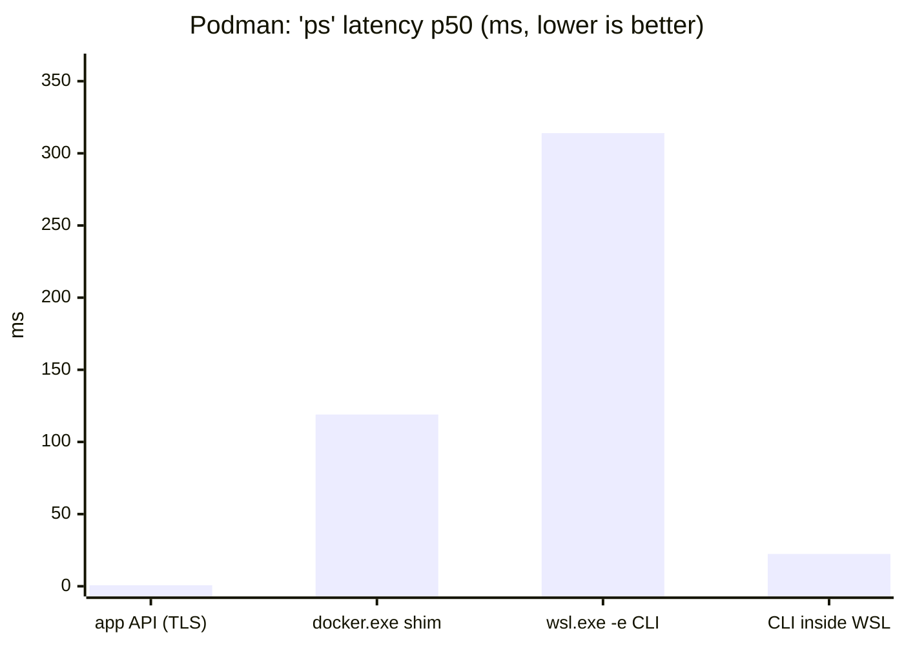
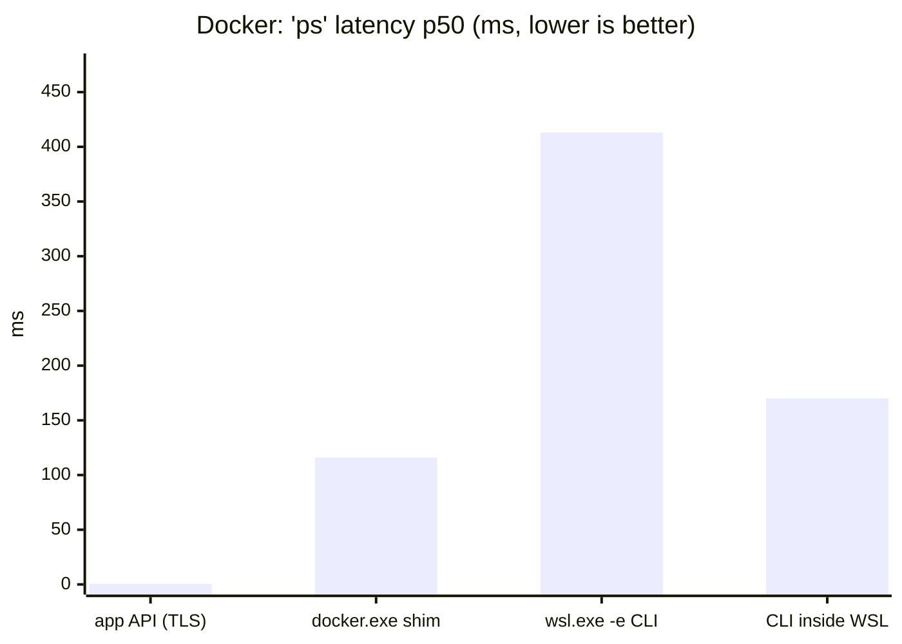
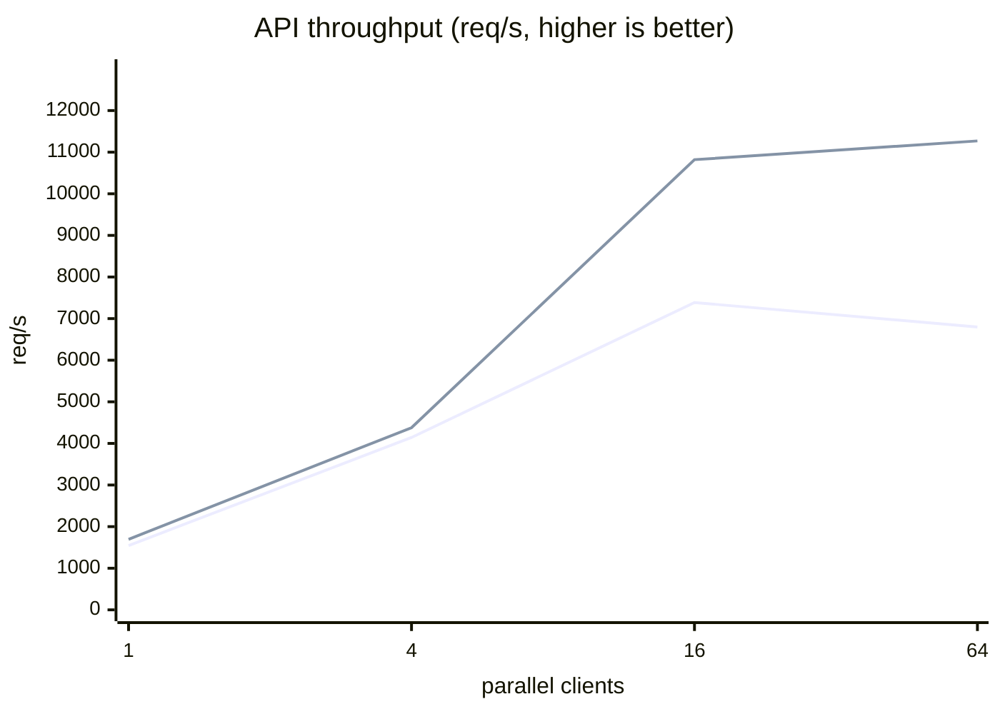

# Benchmark: Docker vs Podman in WSL Container Desktop

> Generated by `scripts/bench.ps1` (`cargo test --release live_bench -- --ignored`) on 2026-11-20 from commit `cc91d5b`. Raw data: [`bench/results.json`](bench/results.json). Numbers come from one machine and are meant for comparing the access paths and the two engines with each other, not as absolute figures.

## Key results

- **The app itself is light:** 12.1 MB EXE, 88.6 MB working set and **0.08 % of total CPU** (1.28 % of one core) while idle, 17 threads.
- **Podman:** `docker ps` from PowerShell through the app's shim takes **119 ms** (p50) vs **314 ms** with plain `wsl.exe -e podman ps` – **2.6× faster**.
- **Docker:** `docker ps` from PowerShell through the app's shim takes **116 ms** (p50) vs **413 ms** with plain `wsl.exe -e docker ps` – **3.6× faster**.
- **API under load:** up to **11270 requests/s** (`GET /containers/json`, Docker, 64 parallel clients over mutual TLS).
- **Functional checks:** 22 / 22 passed.

## Test machine

| | |
|---|---|
| CPU | AMD Ryzen AI 7 PRO 350 w/ Radeon 860M (16 logical cores) |
| RAM | 30.7 GB |
| Windows | Microsoft Windows 11 Enterprise 26200 |
| WSL | 3.0.5.0 |
| App | WSL Container Desktop 0.7.0 |
| Podman | 5.4.2 in distribution `Debian` (Debian GNU/Linux 13 (trixie)) |
| Docker | 29.1.3 in distribution `Ubuntu` (Ubuntu 26.04.1 LTS) |

Both engines were measured one after another. Only one distribution can own the API port at a time (all WSL 2 distributions share one network), so the benchmark switches the primary distribution the same way as *Make primary* in the app, measures the engine through its TLS API with a client certificate (the app's default) and switches back at the end.

## Resource footprint

| Metric | Value |
|---|---|
| `wsl-container-desktop.exe` size | 12.1 MB |
| `docker.exe` shim size | 2.8 MB |
| App working set / private memory | 88.6 MB / 96.1 MB |
| App CPU while idle | 0.08 % of total CPU = 1.28 % of one core (30 s sample) |
| Threads / handles | 17 / 444 |
| WSL VM (`vmmemWSL`) working set, all distributions | 872 MB |
| Podman daemon RSS while idle (podman API service) | 78.7 MB |
| Docker daemon RSS while idle (dockerd + containerd) | 162 MB |
| Switch the primary engine to Docker in `Ubuntu` (*Make primary*: API moved, certificates, keep-alive) | 10.3 s |

No extra helper distribution, background service or browser engine is installed on Windows – the engine runs in a distribution you already have.

## Latency of everyday operations

Four ways to reach the same engine:

- **app API (TLS)** – the Rust client the GUI uses (mutual TLS, keep-alive);
- **docker.exe shim** – the `docker` command the app puts on PATH in Windows (read-only commands answered directly from the API, the rest through `wsl.exe`);
- **wsl.exe -e CLI** – what you would type without the app: `wsl -d <distro> -e docker …`;
- **CLI inside WSL** – the engine's own CLI run inside the distribution (no Windows ↔ WSL boundary; baseline).

| Operation | Path | Podman p50 | Podman p95 | Docker p50 | Docker p95 |
|---|---|--:|--:|--:|--:|
| `version` | app API (TLS) | 94.5 ms | 103 ms | 4.7 ms | 5.0 ms |
| `version` | docker.exe shim | 170 ms | 208 ms | 120 ms | 164 ms |
| `version` | wsl.exe -e CLI | 339 ms | 395 ms | 420 ms | 488 ms |
| `version` | CLI inside WSL | 119 ms | 142 ms | 174 ms | 218 ms |
| `ps` | app API (TLS) | 0.7 ms | 0.8 ms | 0.5 ms | 0.6 ms |
| `ps` | docker.exe shim | 119 ms | 159 ms | 116 ms | 118 ms |
| `ps` | wsl.exe -e CLI | 314 ms | 397 ms | 413 ms | 461 ms |
| `ps` | CLI inside WSL | 22.4 ms | 30.2 ms | 170 ms | 220 ms |
| `images` | app API (TLS) | 5.5 ms | 7.3 ms | 44.8 ms | 56.0 ms |
| `images` | docker.exe shim | 118 ms | 161 ms | 120 ms | 138 ms |
| `images` | wsl.exe -e CLI | 338 ms | 438 ms | 447 ms | 485 ms |
| `images` | CLI inside WSL | 34.4 ms | 38.8 ms | 209 ms | 251 ms |
| `run --rm` | app API (TLS) | 401 ms | 463 ms | 526 ms | 552 ms |
| `run --rm` | docker.exe shim | 708 ms | 810 ms | 930 ms | 1054 ms |
| `run --rm` | wsl.exe -e CLI | 663 ms | 5583 ms | 764 ms | 854 ms |
| `run --rm` | CLI inside WSL | 370 ms | 443 ms | 581 ms | 654 ms |

All times in milliseconds; read operations 20 runs, `run --rm` 8 runs, after warm-up.





## Load test: engine API

Parallel clients calling `GET /containers/json?all=1` through the app's TLS client for a fixed time.

| Parallel clients | Podman req/s | Podman p50 | Podman p95 | Podman errors | Docker req/s | Docker p50 | Docker p95 | Docker errors |
|--:|--:|--:|--:|--:|--:|--:|--:|--:|
| 1 | 1544 | 0.6 ms | 0.8 ms | 0 | 1696 | 0.6 ms | 0.7 ms | 0 |
| 4 | 4143 | 0.9 ms | 1.3 ms | 0 | 4378 | 0.9 ms | 1.1 ms | 0 |
| 16 | 7386 | 1.4 ms | 6.4 ms | 0 | 10820 | 1.3 ms | 2.8 ms | 0 |
| 64 | 6798 | 5.3 ms | 28.6 ms | 0 | 11270 | 3.8 ms | 15.2 ms | 0 |



Lines in order: Podman, then Docker.

## Load test: many containers at once

| Metric | Podman | Docker |
|---|--:|--:|
| Containers created + started (parallel) | 50 / 50 (10×) | 50 / 50 (10×) |
| Time to create + start all | 3.88 s | 3.88 s |
| Throughput | 12.9 containers/s | 12.9 containers/s |
| App refresh (snapshot) with all running, p50 | 260 ms | 360 ms |
| App refresh (snapshot) with all running, p95 | 344 ms | 403 ms |
| Memory per idle container (approx.) | 1.8 MB | 5.9 MB |
| Events received (start / remove) | 50 / 50 of 50 | 50 / 50 of 50 |
| Time to force-remove all | 9.25 s | 3.83 s |

## Functional checks

| Check | Podman | Docker |
|---|:-:|:-:|
| API ping (TLS, client certificate) | ✅ 50.4 ms | ✅ 50.3 ms |
| Plain HTTP without certificate is rejected | ✅ 5.4 ms | ✅ 6.7 ms |
| Engine info | ✅ 97.9 ms | ✅ 51.8 ms |
| Pull image | ✅ 1556 ms | ✅ 1383 ms |
| Run container + read logs | ✅ 492 ms | ✅ 546 ms |
| Stop / start / restart | ✅ 1120 ms | ✅ 2328 ms |
| Volume create / remove | ✅ 33.3 ms | ✅ 11.6 ms |
| Network create / remove | ✅ 45.8 ms | ✅ 265 ms |
| Build from Dockerfile (app build path) | ✅ 2150 ms | ✅ 2637 ms |
| docker.exe shim: ps (fast path) | ✅ 157 ms | ✅ 158 ms |
| docker.exe shim: run --rm (via wsl.exe) | ✅ 633 ms | ✅ 993 ms |

## Docker or Podman?

WSL Container Desktop runs either engine with the same UI, the same `docker` command in Windows, the same TLS-protected API and the same named pipe for IDEs – you can keep both in two distributions side by side and switch the primary one with one click. Use the tables above to pick: Docker is the reference implementation of the API and of Compose; Podman has no long-running containerd stack and is daemonless by design (the app runs its API service only so that Windows tools can reach it).

## Why use WSL Container Desktop

- **No Docker Desktop required** – no helper WSL distributions, no Windows services, no web-based UI; one native EXE of a few MB with near-zero idle CPU (see *Resource footprint*).
- **The `docker` command just works from PowerShell** – and the shim answers read-only commands straight from the API, several times faster than going through `wsl.exe` (see *Latency*).
- **Docker and Podman with one tool** – the same features for both engines, both verified by the functional checks above.
- **Secure by default** – the API is reachable only with the client certificate the app generates; plain HTTP is rejected (functional check).
- **Free for any use** – no per-seat subscription for the GUI.

## Method and reproducing

```powershell
powershell -ExecutionPolicy Bypass -File scripts\bench.ps1          # full run (~10 minutes)
powershell -ExecutionPolicy Bypass -File scripts\bench.ps1 -Quick   # smoke run (~2 minutes)
```

- Distributions are taken from the app configuration (`distro_engines`), or from `WSLCD_BENCH_DOCKER` / `WSLCD_BENCH_PODMAN`.
- For each engine the test makes its distribution primary (as *Make primary* does, with an isolated copy of the app configuration); at the end it restores the original primary and checks that the running app reaches its API again. Containers, volumes, networks and images created by the test are prefixed `wslcd-bench` and removed.
- Test containers trap `SIGTERM`, so stop and removal times measure the engine, not the 10 s stop timeout that a plain `sleep` as PID 1 causes.
- App footprint is read from the running `wsl-container-desktop.exe` as it is (window or tray). CPU is the process CPU time over the sample divided by wall time and by the number of logical cores – a share of the whole CPU like Task Manager. The method was checked against the Windows performance counter (`Win32_PerfRawData_PerfProc_Process`, identical result) and a calibration load (one busy core = 6.24 % measured vs 6.25 % expected on 16 cores). With the window in the tray the app refreshes less often, so idle CPU is lower still.
- Memory per container is the difference of `free -m` inside the WSL VM before and after starting the batch, divided by the number of containers.
- Docker Desktop and Podman Desktop were **not** installed on the test machine, so they are not part of the measurements.

